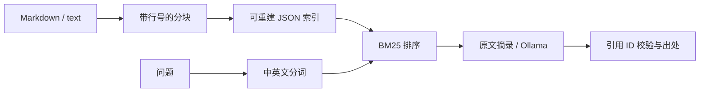

# Evidence RAG

**问自己的学习笔记，每个检索结果都能追溯到原文件和行号。** A small, inspectable Chinese/English retrieval pipeline with an optional local LLM adapter.

零第三方依赖，Node.js **22.14+**。默认在本地检索和摘录，不需要 API Key。接入 Ollama 后才会生成自然语言回答。适合学习信息检索、RAG 的证据边界与模型适配。

## 一分钟运行

```sh
git clone https://github.com/hxl-0926/evidence-rag.git
cd evidence-rag
node src/cli.mjs index examples/notes output/index.json
node src/cli.mjs ask output/index.json "主动回忆是什么？"
npm test
```

输出包含 `mode`、`answer`、`citations` 和 `evidence`。`evidence` 中有 `source`、`startLine`、`endLine` 与 BM25 分数。默认 `mode: extractive` 代表原文摘录；无词项匹配时返回 `mode: abstain`。

## 用自己的资料

```sh
node src/cli.mjs index ./my-notes output/mine.json
node src/cli.mjs ask output/mine.json "事务和幂等有什么区别？" --k 3
```

递归读取 UTF-8 `.md`、`.txt`，跳过隐藏项和符号链接。索引包含笔记原文，请保存在被 Git 忽略的 `output/` 中。编辑笔记后重新建立索引。原始文件单行超过分块目标长度时，会保留整行以保证行号可追溯；这不是严格的 token 预算器。

## 本地模型（可选）

先自行安装 Ollama 并下载适合机器的模型，再把 `YOUR_MODEL` 替换为已安装的名称：

```sh
node src/cli.mjs ask output/index.json "如何避免重复写入？" --model YOUR_MODEL
```

支持 `--url http://127.0.0.1:11434`。服务端点收到检索片段，请只选择你信任的端点。适配器调用 [Ollama `/api/generate`](https://docs.ollama.com/api/generate)，关闭流式返回，要求 JSON，设置超时，并拒绝未检索到的引用 ID。模型调用失败会明确报错，不会伪装成生成成功。

**引用存在不等于事实正确。** 当前只验证引用 ID 属于检索集合，不验证回答逐句蕴含关系；提示词也不能彻底消除资料中的指令注入。默认摘录模式方便直接核对证据。本项目尚未在当前交付环境中对真实 Ollama 模型做端到端验证，适配器测试使用模拟 HTTP 响应。

## 实现看点



- 中文单字和相邻双字召回，英文 NFKC 归一化；没有依赖外部分词器。
- BM25 包含词频饱和、逆文档频率和文档长度归一化。
- 基于来源、起始行和正文内容生成稳定片段 ID，重建后可检查证据变更。
- 写索引先写临时文件再重命名，降低中途中断留下半个 JSON 的概率。
- 核心算法与 CLI、模型适配器分离，可直接通过模块导入使用。

索引构建后查询仍扫描全部片段，适合个人笔记规模；未实现向量检索、同义词语义召回或大规模持久倒排索引。BM25 分数不是置信概率，无匹配拒答也不能识别所有“词项相关但证据不足”的问题。

## 学习与验证

可以把实际检索结果交给配套的 [RAG Bench](https://github.com/hxl-0926/rag-bench) 做评测（假设两个仓库在同一父目录）：

```sh
node src/cli.mjs run output/index.json examples/questions.jsonl output/run.jsonl 3
node ../rag-bench/src/cli.mjs evaluate examples/questions.jsonl output/run.jsonl output/report.json 3
```

此 runner 评测默认摘录流程，以文件路径作为统一 ID，将排名前 100 个片段按文件去重后取前 k 个文件；不包含模型生成耗时。默认摘录把所有返回文件作为引用，相关性和不必要引用会同时体现在评测中。自带问题只用于流程验证，请另建留出集。

`npm test` 验证中英文分词、排序、空集、分块行号、未知引用、模型错误响应。GitHub Actions 配置覆盖 Windows/Linux 与 Node 22/24；实际运行状态以 Actions 为准。

建议先读 [学习路线](docs/LEARNING.md)，再改自己的问题和笔记。MIT License；初始实现有 AI 协助，示例资料为合成演示材料。
